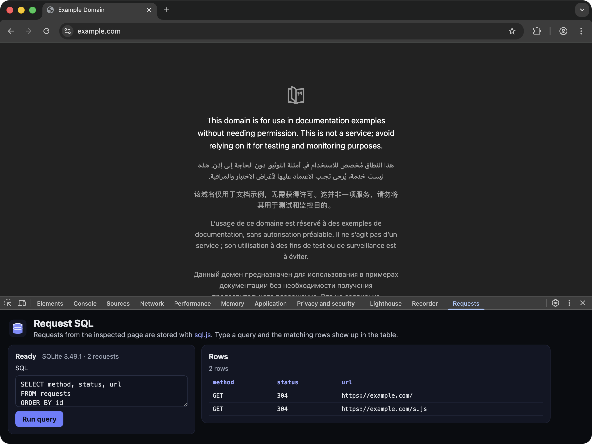

[powered-image]: https://img.shields.io/badge/Powered%20by-Extension.js-0971fe
[powered-url]: https://extension.js.org

![Powered by Extension.js][powered-image]

# SQLite DevTools Panel Example

> Records the inspected page's network requests in SQLite and lets you query them.



**What you'll see**: A DevTools panel with a SQL box and a table of the rows that query returns.

**How it works**: The manifest registers a `devtools_page`, which has no UI of its own: its only job is to call `chrome.devtools.panels.create`. The panel it registers is a TypeScript page bundled from `src/panel/`.

Records each request from the inspected page in [sql.js](https://www.npmjs.com/package/sql.js) (SQLite compiled to WebAssembly). The WebAssembly binary is bundled into the extension, so opening the panel does not fetch it from a CDN.

## Try it locally

```bash
npx extension@latest create my-devtools-typescript-sqlite --template devtools-typescript-sqlite
cd my-devtools-typescript-sqlite
npm install
npm run dev
```

A fresh browser window opens with the extension already loaded.

## Project layout

```
src/
├── devtools/
│   ├── index.html
│   └── scripts.ts
├── images/
│   ├── icon-128.png
│   ├── icon-16.png
│   ├── icon-32.png
│   ├── icon-48.png
│   └── icon-64.png
├── panel/
│   ├── index.html
│   ├── scripts.ts
│   ├── sql-js.d.ts
│   └── styles.css
└── manifest.json
```

## Commands

Cloned this repo instead? The examples ship without npm scripts, so run Extension.js directly from the example directory. Run `npm install` first when the example declares dependencies.

### dev

Run the extension in development mode. Target a browser with `--browser`:

```bash
npx extension@latest dev .                  # Chromium (default)
npx extension@latest dev . --browser=chrome
npx extension@latest dev . --browser=edge
npx extension@latest dev . --browser=firefox
```

### build

Build for production:

```bash
npx extension@latest build .                # Chromium (default)
npx extension@latest build . --browser=firefox
npx extension@latest build . --browser=edge
```

### preview

Preview the production build with the bundled browser:

```bash
npx extension@latest preview .
```

## Tests

This template ships an end-to-end check (`template.spec.ts`) validated by the examples-repo CI on every commit.

## Learn more

- [Extension.js docs](https://extension.js.org)
- [Templates index](https://extension.js.org/docs/getting-started/templates)
- [GitHub: extension-js/extension.js](https://github.com/extension-js/extension.js)
